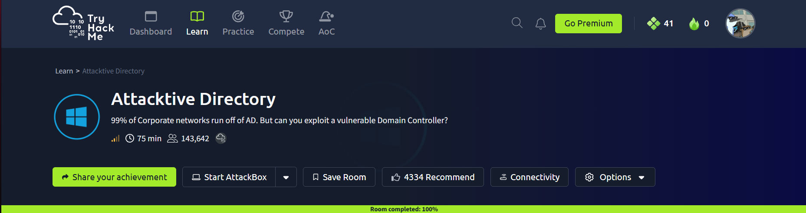
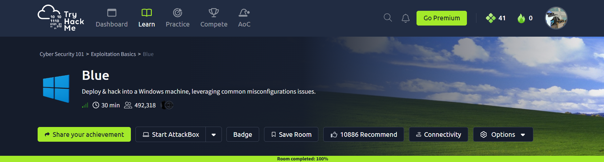
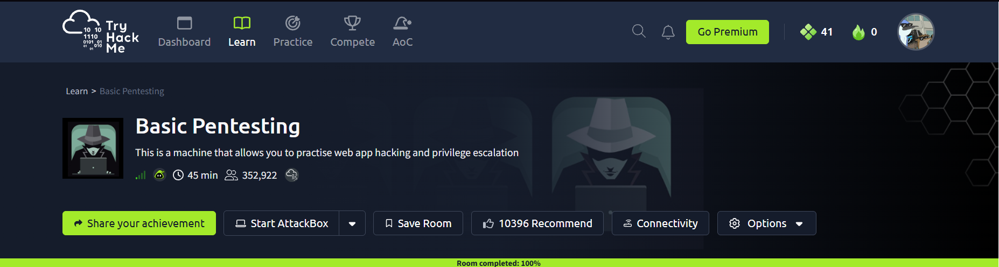
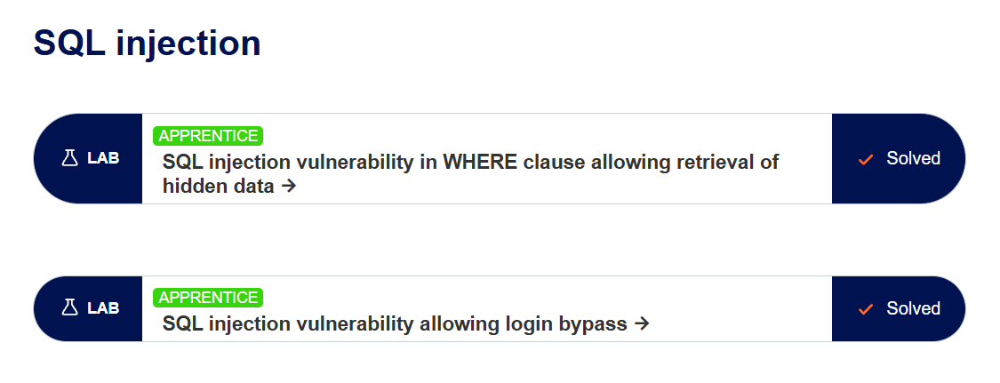
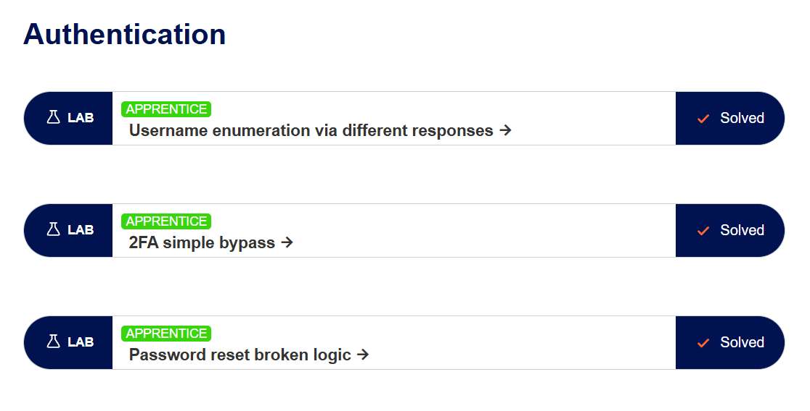

# Cybersecurity Portfolio

Welcome to My Cybersecurity Portfolio!

Hello! My name is Zoe Mirielle Varma. This portfolio showcases my cybersecurity skills, projects, certifications and learning journey as I continue developing my knowledge and practical experience in cybersecurity.

## 1. About Me

I am currently pursuing an MSc in Cyber Security at Universiti Malaya (UM), having previously completed a degree in Computing at the University of Bolton. My background in computing and software development led me to explore cybersecurity, particularly penetration testing and vulnerability assessment.

I am interested in learning how security vulnerabilities are identified, exploited and addressed. Through my university studies, practical labs and independent learning, I am continuing to develop my technical skills and gain hands-on experience in the field. I enjoy exploring different security tools, investigating vulnerabilities and understanding how weaknesses in systems and applications can be addressed. I am particularly interested in web application security, network security and ethical hacking, and I hope to continue building practical experience in these areas.

## 2. Technical Skills

| Skill Area | Tools / Technologies | Proficiency | Related Project |
|---|---|---|---|
| Network Scanning | Nmap | Working Knowledge | [Metasploitable2](projects/virtual-lab-and-network-enumeration/README.md) |
| Network Analysis | Wireshark | Working Knowledge | — |
| Operating Systems | Kali Linux | Working Knowledge | [Metasploitable2](projects/virtual-lab-and-network-enumeration/README.md) |
| Web Application Security | Burp Suite | Working Knowledge | [Web and Network VAPT](projects/web-network-vapt/README.md) |
| Penetration Testing | Metasploit Framework | Beginner | [Metasploitable2](projects/virtual-lab-and-network-enumeration/README.md) |
| Programming and Scripting | Python | Working Knowledge | — |
| Web Development | HTML, CSS, JavaScript, PHP | Working Knowledge | — |
| Virtualisation | Oracle VirtualBox | Working Knowledge | [Metasploitable2](projects/virtual-lab-and-network-enumeration/README.md) |
| Version Control | Git, GitHub | Beginner | [Portfolio Repository](https://github.com/Unknown8922/cybersecurity-portfolio) |

## 3. Certifications and Training

### 3.1 Professional Certifications

| Certification | Issuing Organisation | Date Earned | Status | Verification |
|---|---|---|---|---|
| CompTIA Security+ | CompTIA | July 2024 | Earned | [View Credly Badge](https://www.credly.com/badges/c47d117d-76bc-4742-a780-b05d4a4e9c74/linked_in_profile) |
| Certified Ethical Hacker (CEH v13) | EC-Council | September 2025 | Expired | [Verify Certificate](https://aspen.eccouncil.org/VerifyBadge?type=certification&a=XU3j1XIGm%2Bk2YU91bQi5mMoGhQ730HismNs%2BX71zrQU%3D) |

### 3.2 TryHackMe – Completed Rooms

| Room | Difficulty | Skills Practised |
|---|---|---|
| Mr Robot CTF | Medium | Web enumeration, vulnerability discovery and privilege escalation |
| Attacktive Directory | Medium | Active Directory enumeration and Kerberos attacks |
| Blue | Easy | Windows enumeration and exploitation |
| Basic Pentesting | Easy | Network enumeration and password attacks |
| RootMe | Easy | Web exploitation and privilege escalation |

### 3.3 PortSwigger Web Security Academy – Completed Labs

| Lab | Difficulty | Vulnerability / Skill |
|---|---|---|
| SQL injection vulnerability allowing login bypass | Apprentice | SQL injection and authentication bypass |
| Basic SSRF against the local server | Apprentice | SSRF and accessing internal localhost resources |
| File path traversal, simple case | Apprentice | File path traversal and unauthorised file access |
| File path traversal, traversal sequences blocked with absolute path bypass | Practitioner | Path traversal using absolute path bypass |
| Insecure direct object references | Apprentice | Insecure Direct Object References (IDOR) |

### 3.4 University Coursework – In Progress

| Institution | Programme | Areas |
|---|---|---|
| Universiti Malaya | MSc Cyber Security | Cybersecurity, network security and penetration testing coursework |

### 3.5 Practical Learning Evidence

I have completed hands-on cybersecurity exercises through TryHackMe and PortSwigger Web Security Academy. These activities have allowed me to practise different techniques involving network enumeration, Windows security, web application vulnerabilities and penetration testing.

**TryHackMe – Completed Rooms**

**1. Mr Robot CTF**

**2. Attacktive Directory**

**3. Blue**

**4. Basic Pentesting**

**5. RootMe**

**PortSwigger Web Security Academy – Practical Evidence**

The following screenshots provide examples of my completed practical exercises in web application security.

**1. SQL Injection**

**2. Server-Side Request Forgery (SSRF)**

**3. Path Traversal**

**4. Access Control**

**5. Authentication**

## 4. Projects

### 4.1 Web and Network Vulnerability Assessment and Penetration Testing (VAPT)

An authorised VAPT engagement completed during my internship. The assessment involved reconnaissance, network scanning, service enumeration, vulnerability analysis and controlled validation.

**Tools:** Nmap, Burp Suite, Nikto, WHOIS, Dig and other security utilities.

[View Project](projects/web-network-vapt/README.md)

### 4.2 Metasploitable2 Vulnerability Assessment and Exploitation

A practical penetration-testing exercise using an intentionally vulnerable virtual machine. The assessment involved identifying exposed services and validating vulnerabilities involving VSFTPD, SUID Nmap and UnrealIRCd.

**Tools:** Kali Linux, Nmap, Metasploit Framework, Netcat and Oracle VirtualBox.

[View Project](projects/virtual-lab-and-network-enumeration/README.md)

## 5. Learning Journey

Throughout this course, I have developed a better understanding of cybersecurity and how different security concepts are applied in practice. Before starting the course, most of my knowledge came from my previous computing studies, certifications and independent learning. However, the coursework and practical exercises have helped me understand some areas in greater depth and connect theoretical concepts with practical security testing.

One of the most useful practical activities was the Metasploitable2 vulnerability assessment and exploitation lab. I used Kali Linux and Nmap to discover active hosts, scan open ports and identify running services. I then investigated three vulnerabilities involving VSFTPD, SUID-enabled Nmap and UnrealIRCd. Using Metasploit, I was able to validate the vulnerabilities and obtain root access on the intentionally vulnerable target. This exercise helped me understand how exposed services and insecure configurations can create opportunities for attackers. It also taught me that successful exploitation should be followed by verification. Using commands such as `whoami` and `id` helped me confirm the level of access obtained rather than simply relying on the Metasploit output.

Another important area I explored during this course was network technology and security. I learned more about the importance of network services, open ports and service identification when assessing a system. Using tools such as Nmap helped me understand how information gathered during reconnaissance and enumeration can guide further investigation. I also developed a better understanding of vulnerability assessment techniques and how security tools and testing methods can be used together. This helped me see why it is important to interpret scan results, investigate potential vulnerabilities and evaluate their risks rather than simply running scans and relying on automated findings.

One issue I encountered during the practical lab was an unsuccessful Nmap scan because I entered the target IP address incorrectly. The command contained an extra full stop in the address, so Nmap could not resolve the target. After checking the command, I identified the typing mistake, corrected the IP address and ran the scan again. This taught me to check basic command syntax and target information before assuming that a tool or network is not working. It also reminded me that troubleshooting often starts with checking the simplest possible causes.

One area I still find challenging is understanding which vulnerabilities are relevant to an identified service and selecting the appropriate way to validate them. Although I have gained experience using Nmap and Metasploit, I still need more practice interpreting scan results, researching vulnerabilities and understanding why a particular exploitation method works. I also want to become more confident in explaining the technical impact of a vulnerability and selecting suitable remediation measures.

My improvement goal is to become more confident in vulnerability assessment and exploitation. By 31 January 2027, I aim to complete at least four additional hands-on penetration-testing labs using platforms such as TryHackMe or PortSwigger Web Security Academy. I will measure my progress by keeping notes of each lab, documenting the vulnerabilities identified, the steps used to validate them and the lessons learned. This will help me improve my practical skills and build a stronger foundation for my future goal of becoming a penetration tester.

## 6. Career Objective

My career goal is to become a Penetration Tester, focusing on identifying and assessing security vulnerabilities in web applications, networks and systems. I am particularly interested in vulnerability assessment, web application security and ethical hacking.

To work towards this goal, my next steps are to continue developing my practical skills through hands-on labs on platforms such as TryHackMe and PortSwigger Web Security Academy, improve my scripting and automation knowledge using Python and Bash, and gain further experience conducting vulnerability assessments and documenting technical findings. I also plan to strengthen my understanding of network security, web application vulnerabilities and penetration-testing methodologies.

Through my MSc studies and continued independent practice, I hope to build the technical knowledge and practical experience required for a professional penetration-testing role.

## 7. Contact Information

Thank you for visiting my cybersecurity portfolio.

- **GitHub:** [Unknown8922](https://github.com/Unknown8922)
- **LinkedIn:** [Zoe Varma](https://www.linkedin.com/in/zoe-varma/)
